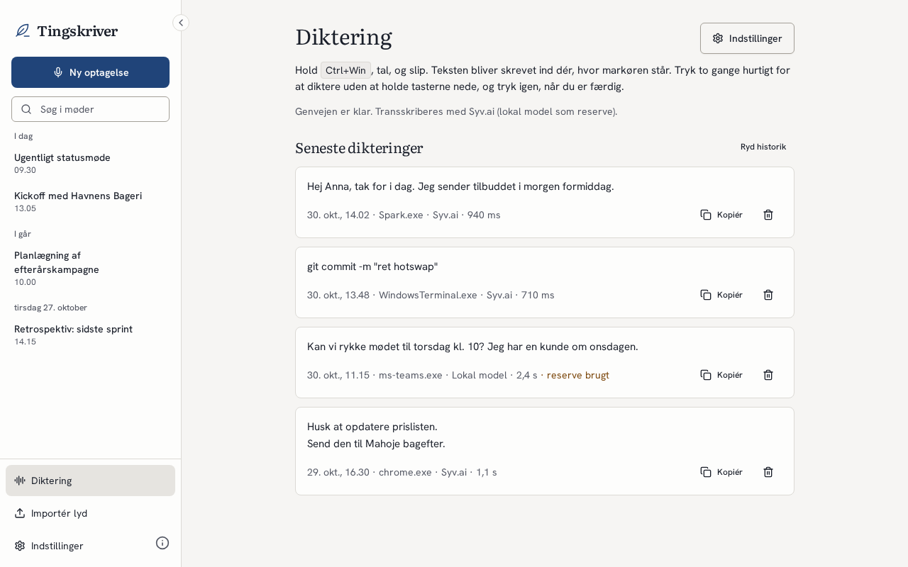
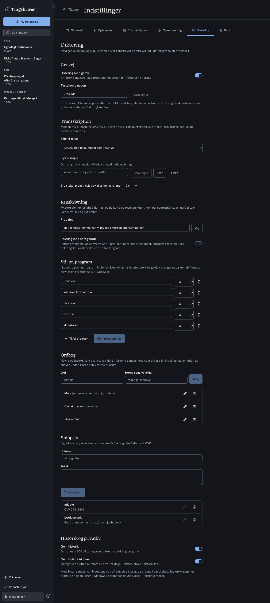

# Tingskriver

## Dansk

Tingskriver optager og transskriberer møder på din Windows-computer, og alt kører lokalt. Lyd, transskription og resuméer forlader ikke maskinen, medmindre du selv vælger en ekstern AI-tjeneste. Programmet er lavet til danske brugere, er gratis og open source, og der er ingen Pro-version eller betalingsmur.

Projektside: <https://tingskriver.mahoje.dk>

| | |
|---|---|
|  |  |
|  |  |

Skærmbillederne er taget med mock-data af `frontend/scripts/screenshots.cjs`.

### Installation

1. Hent installationsfilen (`.exe`) fra [den seneste udgivelse](https://github.com/mahope/tingskriver/releases/latest).
2. Kør filen. Installationsfilen er ikke signeret, så Windows SmartScreen viser en advarsel. Vælg "Flere oplysninger" og derefter "Kør alligevel".
3. Programmet opdaterer sig selv fra GitHub Releases.

Tingskriver understøtter kun Windows 11 (x64). Udgivelserne indeholder ikke macOS- eller Linux-versioner, selvom koden fra det oprindelige projekt stadig ligger i repoet.

### Diktering

Hold `Ctrl+Win`, tal, og slip. Teksten bliver renskrevet og skrevet ind dér, hvor markøren står, i alle programmer. To hurtige tryk dikterer håndfrit, til du trykker igen. En lille pille nederst på skærmen viser lydniveauet og "Skriver …", og den tager aldrig fokus fra det program, du skriver i. Genvejen kan ændres under Indstillinger → Diktering.

- **Tale til tekst:** Med en Syv.ai-nøgle bruges Syv.ai (dansk). Fejler Syv.ai, eller svarer den ikke inden for 2 sekunder, bruges den lokale Parakeet-model automatisk. Uden nøgle bruges kun den lokale model.
- **Renskrivning:** øh og altså fjernes, og du kan sige tegn: "punktum", "komma", "spørgsmålstegn", "udråbstegn", "kolon", "ny linje" og "nyt afsnit". Sætninger får stort begyndelsesbogstav. I kodeprogrammer og terminaler (fx VS Code og Windows Terminal) skrives teksten råt. Polering med en sprogmodel kan slås til, men er slået fra som standard.
- **Ordbog og snippets:** Egne ord og navne staves rigtigt, og en talt udløser som "mit CVR" kan indsætte en fast tekst.
- **Indsættelse:** Teksten indsættes via udklipsholderen og `Ctrl+V`, og din udklipsholder sættes tilbage bagefter. Hvis et felt ikke tager imod indsæt, skrives teksten tegn for tegn.
- **Historik:** De seneste 500 dikteringer står på siden "Diktering" med svartid og program og kan kopieres igen. Lyden gemmes i 24 timer. Begge dele kan slås fra.

**Privatliv:** Med Syv.ai sendes kun lydoptagelsen af det, du dikterer, sammen med ordene i din ordbog som stikord. Uden nøgle, eller med "Kun lokal model", forlader intet computeren. Nøglen gemmes i Windows Legitimationsstyring, ikke i Tingskrivers filer. Genvejen bruger én tastaturhook, der kun holder øje med genvejens taster. Tastetryk gemmes eller logges aldrig. Programmer, der kører som administrator, kan ikke modtage tekst fra Tingskriver (Windows' UIPI), så kør ikke Tingskriver som administrator.

| | |
|---|---|
|  |  |

### Om projektet

Tingskriver er en fork af [Meetily](https://github.com/Zackriya-Solutions/meetily) fra Zackriya Solutions (MIT-licens). Tingskriver har ingen tilknytning til Zackriya Solutions og er hverken godkendt eller sponsoreret af dem. Se [NOTICE.md](NOTICE.md), [LICENSE.md](LICENSE.md) og [THIRD_PARTY_LICENSES.md](THIRD_PARTY_LICENSES.md) for licenser og tredjepartskomponenter, herunder FFmpeg (GPL-3.0).

### Udvikling

- Udviklingen foregår på Forgejo: `git.mahoje.dk/mahope/tingskriver`. GitHub-repoet [mahope/tingskriver](https://github.com/mahope/tingskriver) er et spejl.
- Et tag på formen `v*` bygger en udgivelse på GitHub Actions og lægger installationsfilen på GitHub Releases.
- Pushes til andre grene end `main` bygger uden at lave en udgivelse.
- Byggevejledning: [docs/BUILDING.md](docs/BUILDING.md). Frontenden ligger i `frontend/` (Tauri 2, Next.js, Rust).
- Logfiler: `%LOCALAPPDATA%\dk.mahoje.tingskriver\logs\` (`tingskriver.log`, roterer ved 5 MB, de to seneste filer gemmes også). Åbn mappen fra Indstillinger under "Logfiler". Enhedsskift står som `[DEVICE_FOLLOW]`-linjer med tidsstempel.
- Test af enhedsskift: `rustc --edition 2021 --test frontend/src-tauri/src/audio/device_follow.rs -o /tmp/df && /tmp/df` (ren std, kører på Linux; det samme gør CI på hver gren). Manuel test på Windows: optag, tag headsettet af og på igen, og tjek at `audio.mp4` ikke har huller og at `[DEVICE_FOLLOW]`-linjerne i loggen viser skiftet inden for ca. 1 sekund.
- Test af diktering: `rustc --edition 2021 --test frontend/src-tauri/src/dictation/logic/mod.rs -o /tmp/dl && /tmp/dl` (renskrivning, genvej, dobbelttryk og reservevalg; ren std, kører også i CI).

## English

Tingskriver is a privacy-first meeting recorder and transcriber for Windows that runs locally. Audio, transcripts and summaries stay on your machine unless you choose an external AI service yourself. It is made for Danish users, is free and open source, and has no Pro version or paywall.

Project page: <https://tingskriver.mahoje.dk>

| | |
|---|---|
|  |  |

The screenshots use mock data and are generated by `frontend/scripts/screenshots.cjs`. The interface is in Danish.

### Installation

1. Download the installer (`.exe`) from the [latest release](https://github.com/mahope/tingskriver/releases/latest).
2. Run it. The installer is unsigned, so Windows SmartScreen shows a warning. Choose "More info" and then "Run anyway".
3. The app updates itself from GitHub Releases.

Tingskriver supports Windows 11 (x64) only. Releases contain no macOS or Linux builds, although the code inherited from the upstream project is still in the repository.

### Dictation

Hold `Ctrl+Win`, speak, and release. The text is cleaned up and typed where your cursor is, in any program. Double-tap to dictate hands-free until the next press. A small pill at the bottom of the screen shows the input level and "Skriver …" (writing), and never takes focus from the program you are typing in. The shortcut can be changed under Settings → Diktering.

- **Speech to text:** With a Syv.ai key, Syv.ai (Danish) is used. If Syv.ai fails or takes longer than 2 seconds, the local Parakeet model is used automatically. Without a key, only the local model is used.
- **Cleanup:** Danish fillers ("øh", "altså") are removed and spoken punctuation ("punktum", "komma", "spørgsmålstegn", "udråbstegn", "kolon", "ny linje", "nyt afsnit") becomes characters. Sentences are capitalised. Code editors and terminals get raw text. Optional LLM polishing is off by default.
- **Dictionary and snippets:** Your own words and names are spelled correctly, and a spoken trigger such as "mit CVR" can insert a fixed block of text.
- **Insertion:** Text is pasted through the clipboard with `Ctrl+V` and your clipboard is restored afterwards. Fields that block paste get the text typed instead.
- **History:** The last 500 dictations are listed on the "Diktering" page with latency and program, and can be copied again. Audio is kept for 24 hours. Both can be turned off.

**Privacy:** With Syv.ai, only the audio of what you dictate is sent, along with your dictionary words as hints. Without a key, or with "local model only", nothing leaves the computer. The key is stored in Windows Credential Manager, not in Tingskriver's files. The shortcut uses one keyboard hook that only watches the shortcut keys; keystrokes are never stored or logged. Programs running as administrator cannot receive text from Tingskriver (Windows UIPI), so do not run Tingskriver as administrator.

### About

Tingskriver is a fork of [Meetily](https://github.com/Zackriya-Solutions/meetily) by Zackriya Solutions (MIT License). Tingskriver is not affiliated with, endorsed by or sponsored by Zackriya Solutions. See [NOTICE.md](NOTICE.md), [LICENSE.md](LICENSE.md) and [THIRD_PARTY_LICENSES.md](THIRD_PARTY_LICENSES.md) for licenses and third-party components, including FFmpeg (GPL-3.0).

### Development

- Development happens on Forgejo: `git.mahoje.dk/mahope/tingskriver`. The GitHub repository [mahope/tingskriver](https://github.com/mahope/tingskriver) is a mirror.
- Pushing a `v*` tag builds a release on GitHub Actions and publishes the installer on GitHub Releases.
- Pushes to branches other than `main` build without creating a release.
- Build instructions: [docs/BUILDING.md](docs/BUILDING.md). The app lives in `frontend/` (Tauri 2, Next.js, Rust).
- Log files: `%LOCALAPPDATA%\dk.mahoje.tingskriver\logs\` (`tingskriver.log`, rotates at 5 MB, the two previous files are kept). Open the folder from Settings under "Logfiler". Device switches appear as `[DEVICE_FOLLOW]` lines with timestamps.
- Testing device switching: `rustc --edition 2021 --test frontend/src-tauri/src/audio/device_follow.rs -o /tmp/df && /tmp/df` (plain std, runs on Linux; CI runs it on every branch). Manual test on Windows: record, take the headset off and put it on again, and check that `audio.mp4` has no gaps and the `[DEVICE_FOLLOW]` lines in the log show the switch within about a second.
- Testing dictation: `rustc --edition 2021 --test frontend/src-tauri/src/dictation/logic/mod.rs -o /tmp/dl && /tmp/dl` (cleanup, shortcut, double tap and fallback decisions; plain std, also run by CI).
