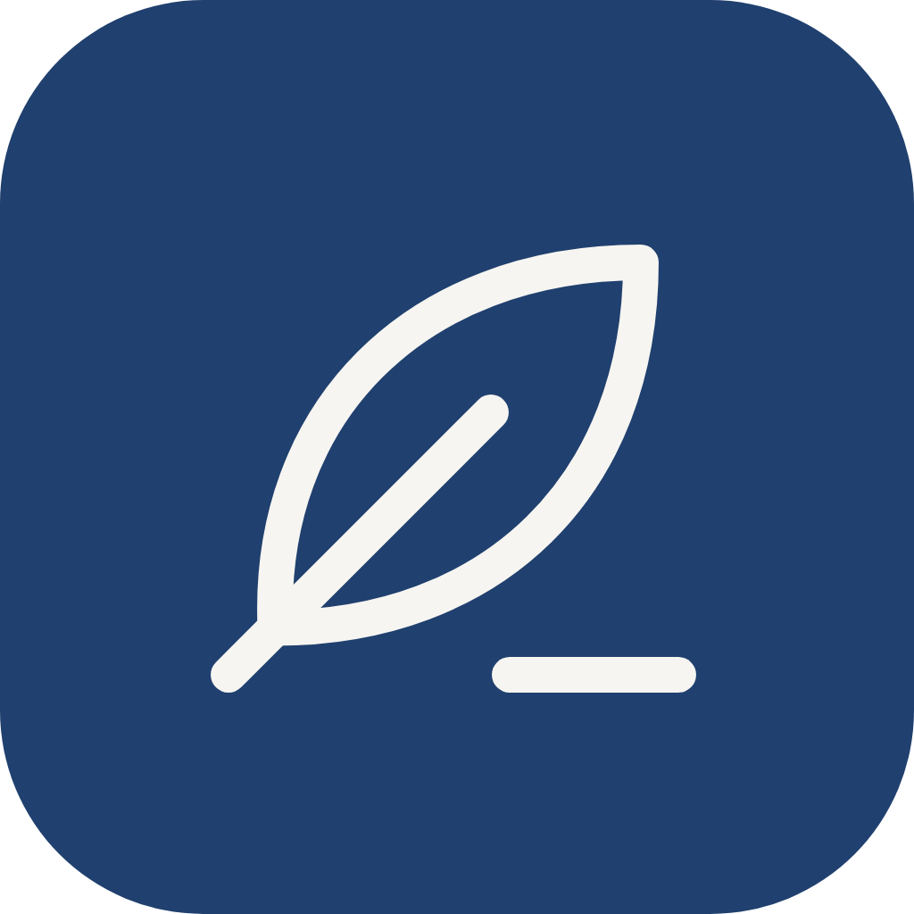
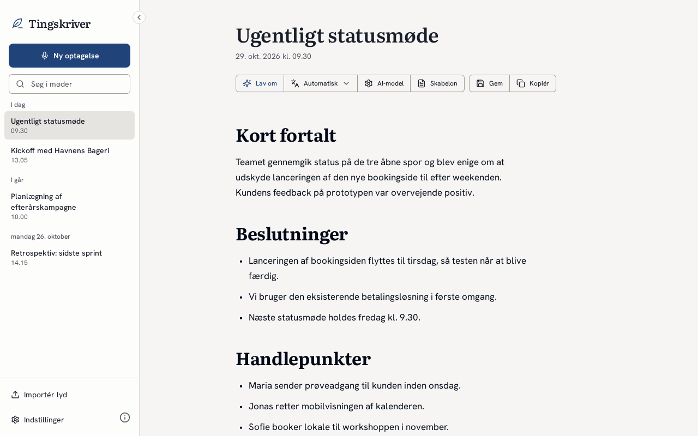
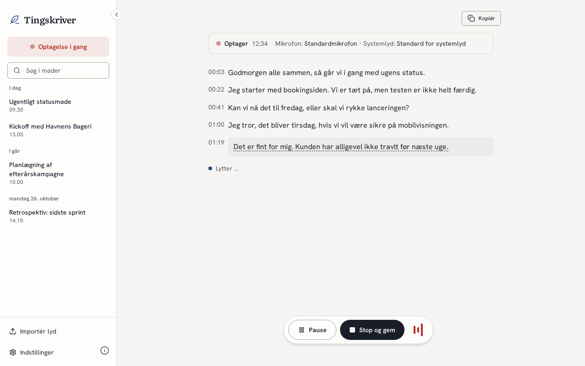
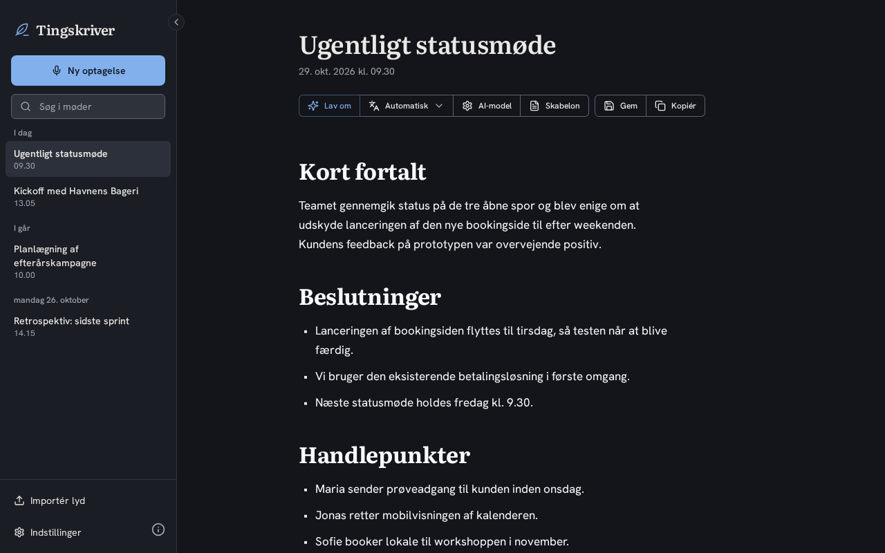
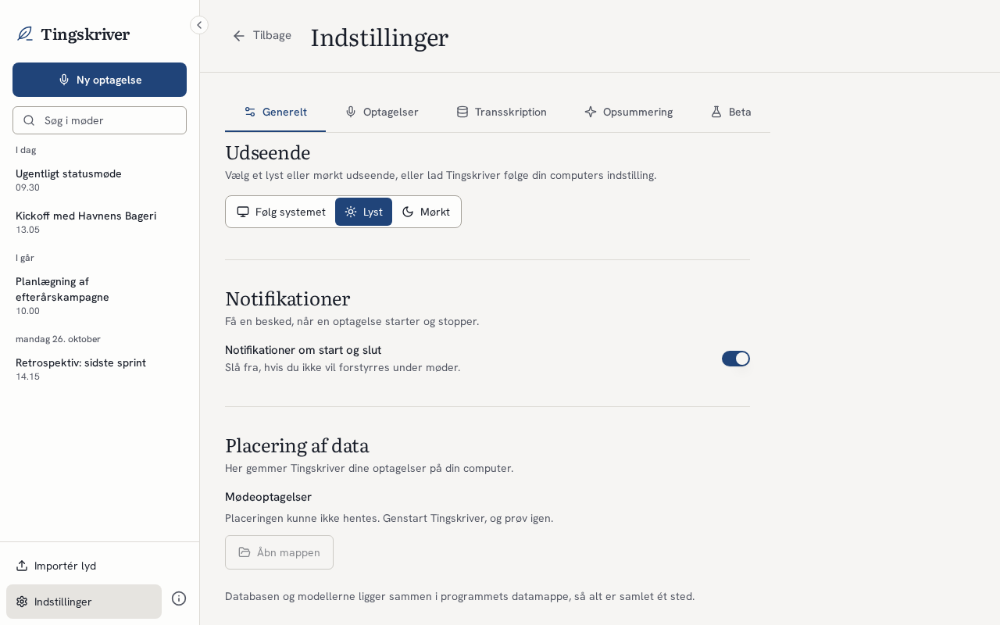
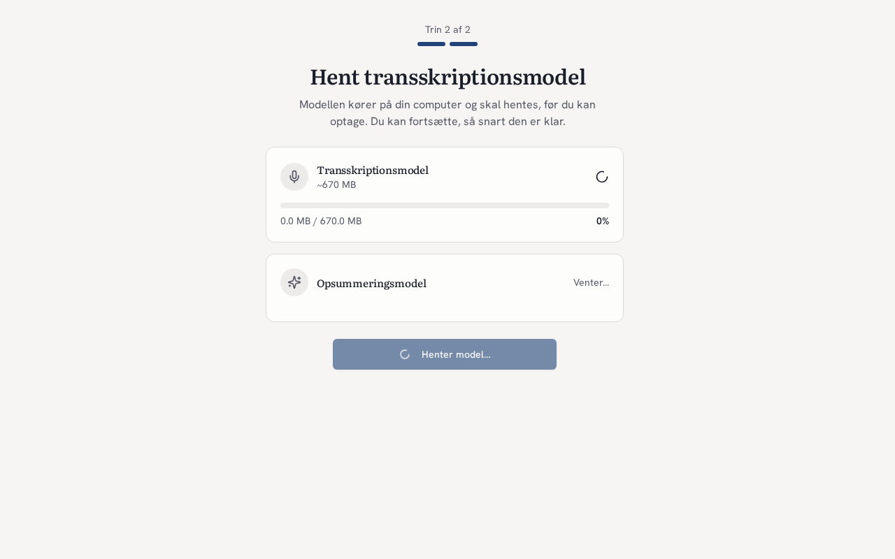
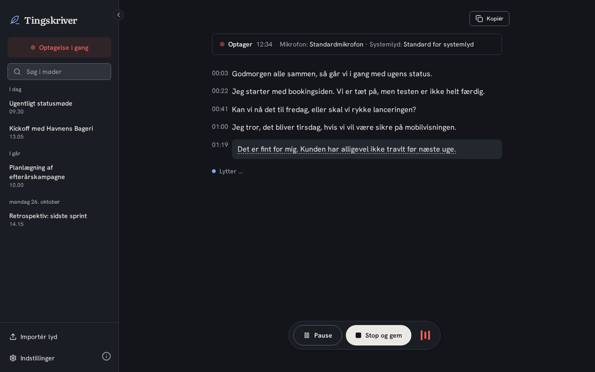

# Tingskriver

## Dansk

Tingskriver optager og transskriberer møder på din Windows-computer, og alt kører lokalt. Lyd, transskription og resuméer forlader ikke maskinen, medmindre du selv vælger en ekstern AI-tjeneste. Programmet er lavet til danske brugere, er gratis og open source, og der er ingen Pro-version eller betalingsmur.

Projektside: <https://tingskriver.mahoje.dk>

| | |
|---|---|
|  |  |
|  |  |

Skærmbillederne er taget med mock-data af `frontend/scripts/screenshots.cjs`.

### Installation

1. Hent installationsfilen (`.exe`) fra [den seneste udgivelse](https://github.com/mahope/tingskriver/releases/latest).
2. Kør filen. Installationsfilen er ikke signeret, så Windows SmartScreen viser en advarsel. Vælg "Flere oplysninger" og derefter "Kør alligevel".
3. Programmet opdaterer sig selv fra GitHub Releases.

Tingskriver understøtter kun Windows 11 (x64). Udgivelserne indeholder ikke macOS- eller Linux-versioner, selvom koden fra det oprindelige projekt stadig ligger i repoet.

### Skift af mikrofon og mute

Under en optagelse følger Tingskriver Windows' standardenheder. Optagelsen skifter kun mikrofon, når den aktive mikrofon reelt fejler:

- enheden fjernes eller deaktiveres (fx headsettet tages ud eller Bluetooth falder ud),
- Windows vælger en anden standardenhed,
- lydstrømmen melder en fejl (fx `AUDCLNT_E_DEVICE_INVALIDATED`),
- lydstrømmen leverer slet ingen lyd-frames i 2 sekunder.

Mute skifter aldrig mikrofon. Det gælder både mute-knappen på headsettet, mute i Windows og lav lydstyrke: en muted mikrofon leverer stadig frames, bare med stilhed, og optagelsen bliver på den. Loggen skriver én linje med "silent frames ignored". Når headsettet kommer igen efter en reel fejl, skifter optagelsen tilbage til det.

### Om projektet

Tingskriver er en fork af [Meetily](https://github.com/Zackriya-Solutions/meetily) fra Zackriya Solutions (MIT-licens). Tingskriver har ingen tilknytning til Zackriya Solutions og er hverken godkendt eller sponsoreret af dem. Se [NOTICE.md](NOTICE.md), [LICENSE.md](LICENSE.md) og [THIRD_PARTY_LICENSES.md](THIRD_PARTY_LICENSES.md) for licenser og tredjepartskomponenter, herunder FFmpeg (GPL-3.0).

### Udvikling

- Udviklingen foregår på Forgejo: `git.mahoje.dk/mahope/tingskriver`. GitHub-repoet [mahope/tingskriver](https://github.com/mahope/tingskriver) er et spejl.
- Et tag på formen `v*` bygger en udgivelse på GitHub Actions og lægger installationsfilen på GitHub Releases.
- Pushes til andre grene end `main` bygger uden at lave en udgivelse.
- Byggevejledning: [docs/BUILDING.md](docs/BUILDING.md). Frontenden ligger i `frontend/` (Tauri 2, Next.js, Rust).
- Logfiler: `%LOCALAPPDATA%\dk.mahoje.tingskriver\logs\` (`tingskriver.log`, roterer ved 5 MB, de to seneste filer gemmes også). Åbn mappen fra Indstillinger under "Logfiler". Enhedsskift står som `[DEVICE_FOLLOW]`-linjer med tidsstempel.
- Test af enhedsskift: `rustc --edition 2021 --test frontend/src-tauri/src/audio/device_follow.rs -o /tmp/df && /tmp/df` (ren std, kører på Linux; det samme gør CI på hver gren). Manuel test på Windows: optag, tag headsettet af og på igen, og tjek at `audio.mp4` ikke har huller og at `[DEVICE_FOLLOW]`-linjerne i loggen viser skiftet inden for ca. 1 sekund. Tryk også på mute på headsettet i mindst 30 sekunder under optagelsen og tjek, at der ikke kommer noget skift.

## English

Tingskriver is a privacy-first meeting recorder and transcriber for Windows that runs locally. Audio, transcripts and summaries stay on your machine unless you choose an external AI service yourself. It is made for Danish users, is free and open source, and has no Pro version or paywall.

Project page: <https://tingskriver.mahoje.dk>

| | |
|---|---|
|  |  |

The screenshots use mock data and are generated by `frontend/scripts/screenshots.cjs`. The interface is in Danish.

### Installation

1. Download the installer (`.exe`) from the [latest release](https://github.com/mahope/tingskriver/releases/latest).
2. Run it. The installer is unsigned, so Windows SmartScreen shows a warning. Choose "More info" and then "Run anyway".
3. The app updates itself from GitHub Releases.

Tingskriver supports Windows 11 (x64) only. Releases contain no macOS or Linux builds, although the code inherited from the upstream project is still in the repository.

### Microphone switching and mute

During a recording Tingskriver follows the Windows default devices. It only switches microphone when the active microphone actually fails:

- the device is removed or disabled (e.g. the headset is unplugged or Bluetooth drops),
- Windows picks another default device,
- the audio stream reports an error (e.g. `AUDCLNT_E_DEVICE_INVALIDATED`),
- the audio stream delivers no audio frames at all for 2 seconds.

Mute never switches microphone. That covers the mute button on the headset, mute in Windows and low volume: a muted microphone still delivers frames, they just contain silence, and the recording stays on it. The log writes a single "silent frames ignored" line. When the headset comes back after a real failure, the recording switches back to it.

### About

Tingskriver is a fork of [Meetily](https://github.com/Zackriya-Solutions/meetily) by Zackriya Solutions (MIT License). Tingskriver is not affiliated with, endorsed by or sponsored by Zackriya Solutions. See [NOTICE.md](NOTICE.md), [LICENSE.md](LICENSE.md) and [THIRD_PARTY_LICENSES.md](THIRD_PARTY_LICENSES.md) for licenses and third-party components, including FFmpeg (GPL-3.0).

### Development

- Development happens on Forgejo: `git.mahoje.dk/mahope/tingskriver`. The GitHub repository [mahope/tingskriver](https://github.com/mahope/tingskriver) is a mirror.
- Pushing a `v*` tag builds a release on GitHub Actions and publishes the installer on GitHub Releases.
- Pushes to branches other than `main` build without creating a release.
- Build instructions: [docs/BUILDING.md](docs/BUILDING.md). The app lives in `frontend/` (Tauri 2, Next.js, Rust).
- Log files: `%LOCALAPPDATA%\dk.mahoje.tingskriver\logs\` (`tingskriver.log`, rotates at 5 MB, the two previous files are kept). Open the folder from Settings under "Logfiler". Device switches appear as `[DEVICE_FOLLOW]` lines with timestamps.
- Testing device switching: `rustc --edition 2021 --test frontend/src-tauri/src/audio/device_follow.rs -o /tmp/df && /tmp/df` (plain std, runs on Linux; CI runs it on every branch). Manual test on Windows: record, take the headset off and put it on again, and check that `audio.mp4` has no gaps and the `[DEVICE_FOLLOW]` lines in the log show the switch within about a second. Also press mute on the headset for at least 30 seconds while recording and check that no switch happens.
