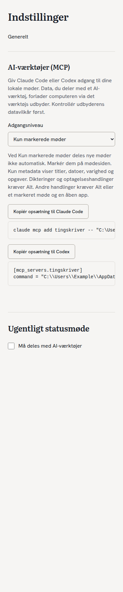
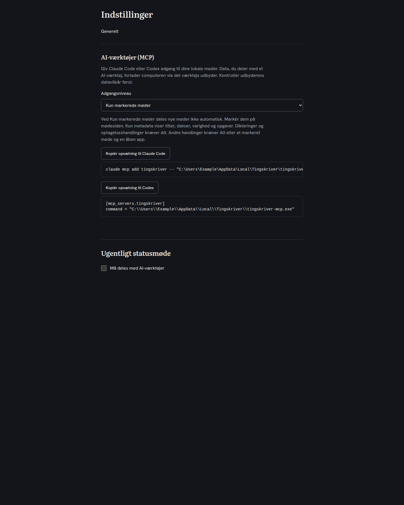

# Local MCP integration

`tingskriver-mcp` uses the official Rust SDK (`rmcp`) over newline-delimited
JSON-RPC stdio. Stdout contains only protocol traffic. No HTTP server, network
port, cloud service or credentials are used by the MCP process.

Build with `cargo build --locked -p tingskriver-mcp`. For a development data
directory, start `tingskriver-mcp --data-dir /absolute/path/to/fixture`.
The default is core's existing app-data directory, including
`%APPDATA%\dk.mahoje.tingskriver` on Windows. It opens the meeting database
and `dictation.sqlite` read-only, without migrations, recovery writes or
creation of missing files. Open the updated app once to apply the migration.

The installer places the server beside the app. Tauri's NSIS installation
normally uses `%LOCALAPPDATA%\Tingskriver`; Velopack uses a versioned/current
directory. Always prefer the setup copied from the running app: it resolves
the actual executable location. Claude Code and Codex launch the same server.
Restart the MCP client after installing an update if it holds an older process.

## Access

| Level | Meetings | Content | Dictation | Actions |
| --- | --- | --- | --- | --- |
| `marked` (default) | Explicitly shared only | Shared meetings | Denied | Shared meetings only |
| `metadata` | All | Titles, dates, duration, tasks | Denied | Denied |
| `all` | All | All | Allowed | Allowed |
| `off` | None | None | Denied | Denied |

Recording actions require `all`: stop has no meeting ID, so it must not bypass
the sharing decision on a hidden recording. New recordings remain unmarked.
There is no owner detection or automatic `all` setting. The owner can select
Alt explicitly. The installed GPUI app's Meetings page lists both shared and
private meetings and lets the owner share or revoke each meeting. Refresh the
list to pick up meetings created while the app is open. Tauri also has a
per-meeting sharing checkbox. Both apps persist the same sharing flag.

Each read snapshots policy and data together. Invalid/missing policy or an old
schema fails closed. Unknown meeting IDs and hidden meetings have the same
error. Search applies sharing and metadata restrictions before LIMIT; snippets
come from the existing FTS5 index, never a separate copy. Metadata search only
matches titles. Tasks are Markdown checkboxes or list items under recognized
task headings in the saved summary; arbitrary surrounding summary text is
never returned as a task. There is no structured task/assignee model yet.

## Tools

| Tool | Arguments |
| --- | --- |
| `list_meetings` | `fra?`, `til?` (SQLite date/ISO time, lower inclusive/upper exclusive), `søg?` (title substring) |
| `get_meeting` | `id`, `dele?` (`referat`, `noter`, `transskript`; default all allowed parts) |
| `search` | `tekst` (literal FTS5 terms, AND) |
| `list_tasks` | `åbne?` (default true) |
| `recent_dictations` | `n?` (default 20, maximum 500) |
| `start_recording` | `titel?` |
| `stop_recording` | none |
| `regenerate_summary` | `id`, `skabelon` (existing template ID) |
| `handoff` | `id`, `mål` (existing delivery target ID) |
| `add_note` | `id`, `tekst` (Markdown to append) |

Actions use `\\.\pipe\tingskriver` on Windows; remote pipe clients are refused.
Unix development uses `mcp-ipc/actions.sock` inside a mode-0700 directory.
Requests and replies are bounded to 64 KiB. Calls time out without automatic
retry: check the app before repeating a timed-out action. The app rechecks
access independently; the MCP process cannot write its own policy, sharing
flags, notes, summaries, targets or queue entries. App logs record operation
name and success, never action arguments or note text. Both app hosts forward
action notifications. Notifications may be limited by OS permissions.

`handoff` approves a snapshot of the saved summary, transcript and notes to an
already configured target; it cannot create a target or bypass delivery policy.
Do not approve it in an AI client unless that delivery is intended. The app's
delivery queue owns all writes, retries and transport. Existing local-only and
private-mode switches still block delivery. There is no persisted per-meeting
private flag in #70; unshare sensitive meetings and use marked-only access,
or enable the delivery private-mode switch.

**Data passed to an external AI tool leaves this computer via that tool's
provider.** The local server cannot enforce a third party's retention policy.

## Verification

`cargo test --locked -p tingskriver-core --test mcp_access --test mcp_actions`
checks opt-in defaults, all access modes, policy refresh, FTS privacy, task
projection, dictation fields and app-side action authorization/notifications.
`cargo test --locked -p tingskriver-mcp` starts the real subprocess, initializes
MCP, discovers tools and calls them with the app closed. UI tests live in
`frontend/tests/lib/mcp.test.tsx`.

Windows release verification still needs an installed app with real audio
devices: add it to both clients, list/get a marked meeting, exercise recording
and regeneration, check action notifications/logs, and run `netstat -ano`
while the server is active. No port should belong to the MCP process. These
hardware/client checks cannot be replaced by Linux fixture tests.

Web control previews use only synthetic data (native GPUI rendering is separate):

